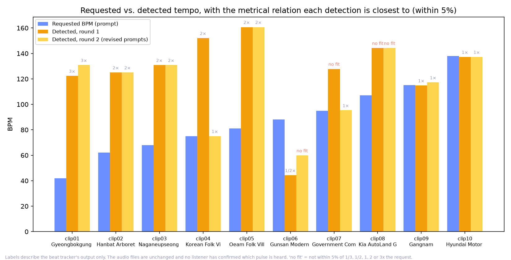
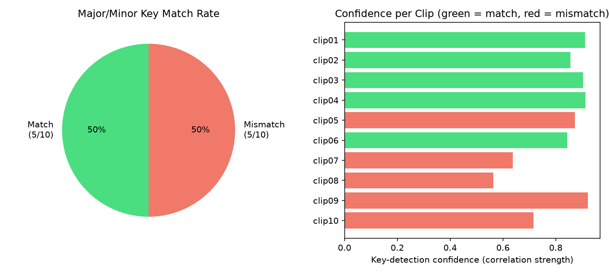

# Moodscape — Prompt vs. Real Generated Audio Verification Report

**This is the first report in this project backed by real generated audio, not an
approximation.** 10 real tracks were generated via a live `sunoapi.org` call (the user's own
API key, stored only in a local, gitignored `.env` file — never logged or committed), using
the exact same request shape `sunoGenerate()` in `audio.js` uses. Each file was then analyzed
directly — tempo and musical key detected from the actual audio waveform — and compared
against what the prompt asked for.

## Method

1. **Generation** (`research/generate_listener_clips.py`): sent each of the 10 prepared
   prompts from `research/listener_stimulus_metadata.csv` to `sunoapi.org`'s `/api/v1/generate`
   endpoint, polled `/api/v1/generate/record-info` until an audio URL appeared, downloaded the
   MP3. All 10 succeeded.
2. **Analysis** (`research/analyze_generated_audio.py`): loaded each MP3 with `librosa`,
   estimated tempo via `librosa.beat.beat_track()`, and estimated the major/minor key via the
   Krumhansl-Schmuckler algorithm — chroma-vector correlation against the standard published
   Krumhansl & Kessler (1982) tone profiles, not something invented for this project. The tool
   also reports an octave-aware tempo reading (see below) and the event density (onsets per
   second) of each track.
3. **Comparison**: requested BPM/key (read straight from each clip's actual `buildSunoPrompt()`
   output) vs. detected BPM/key from the real audio.
4. **Reproducibility**: every figure and statistic below is rebuilt from the analyzer's CSV
   output by `research/build_audio_report_figures.py`. An earlier version of this report quoted
   octave-corrected numbers from a scratch script that was not committed; see "Revision note"
   at the end for what changed when that was fixed.

## Results

Round 1 is the original generation this report is about. Round 2 (right column) is the same ten
places regenerated with the revised prompts and request shape described in
`MINOR_KEY_FIDELITY_STUDY.md`; it is included so the tempo findings are not resting on one draw.

| Metric | Round 1 | Round 2 |
|---|---|---|
| Clips generated and analyzed | 10 / 10 | 10 / 10 |
| Major/minor key match rate | **5/10 (50%)** | 7/10 (70%) |
| Raw mean BPM deviation | 70.6% | 57.4% |
| **Octave-aware mean BPM deviation** (detected may be ⅓, ½, 1, 2 or 3× the request) | **7.7%** | 7.7% |
| Octave-aware median BPM deviation | 1.1% | 1.4% |
| Within 5% of a standard multiple of the request | 8/10 | 8/10 |
| &nbsp;&nbsp;— of which at 1× (tempo matched as requested) | 2 (clip09, clip10) | 4 (clip04, 07, 09, 10) |
| &nbsp;&nbsp;— of which at 2×, 3× or ½× | 6 (clip01 3×; clip02–05 2×; clip06 ½×) | 4 (clip01 3×; clip02, 03, 05 2×) |
| **Not within 5% of any standard multiple** | 2 (clip07, clip08) | 2 (clip06, clip08) |
| Mean key-detection confidence on matches | 0.885 | 0.875 |
| Mean key-detection confidence on mismatches | 0.742 | 0.791 |
| Mean onsets per second, requests ≤ 81 BPM vs. ≥ 107 BPM | 2.5 vs. 6.4 | 2.7 vs. 7.2 |

## The most important finding: the raw BPM number is misleading, but the correction has limits

The literal "70.6% off" headline looks like the audio barely resembles the prompt. That reading
does not hold up for most clips. In round 1, six of the ten detected tempos sit almost exactly on
a simple multiple of the requested tempo: clip02, 03, 04 and 05 at about 2× (0.8–3.8% off),
clip06 at about ½× (0.7% off) and clip01 at about 3× (122.3 BPM against 3 × 42 = 126, 3.0% off).
Two more (clip09, clip10) match the request directly. Slow, sparse, plucked or arpeggiated music
routinely produces this: beat trackers lock onto a faster subdivision of the notes instead of
the slower pulse a person might tap along to. It is a known property of tempo-estimation tools in
general, not evidence specific to Moodscape's prompts or Suno's output.

**Allowing for those multiples** (⅓, ½, 1, 2 or 3× — the standard tolerance in tempo-estimation
evaluation) drops the mean deviation from 70.6% to **7.7%** and the median to **1.1%**; round 2
gives the same mean (7.7%) and a median of 1.4%. **This does not mean the audio was changed,
re-generated, or actually corrected in any way — the MP3 files are untouched.** Only the number
produced by the detector is re-read: librosa reported one BPM value, and this step asks whether
that value is a simple multiple of what the prompt requested. It is a statement about the
detection tool, not a verified finding about the tempo a listener would feel — nobody has
listened to these tracks to confirm which pulse a person would tap.

**Two things the correction does not explain.** In round 1, clip07 (95 requested, 127.8
detected) and clip08 (107 requested, 144.2 detected) are about 33% from every standard multiple;
both are close to 4⁄3 of the request. Round 2 repeats clip08 (144.2 again) and adds clip06 (88
requested, 59.8 detected, about ⅔). These are not octave artifacts, and this report has no
explanation for them. A triplet or compound-meter feel would produce ratios like these, but that
is an untested guess; it needs a listener, not another detector.

**Is the slow request being honoured at all?** Supporting evidence, still short of proof: across
the ten requested tempos, requested BPM and onsets per second rank-correlate at ρ = 0.93 (n = 10
clip means, pooling all 40 tracks on disk; descriptive only; `research/slow_song_diagnostic.py`). Slow requests (≤ 81 BPM)
average 2.5 onsets per second against 6.4 for fast requests (≥ 107 BPM), and the slow clips carry
about 2.3 events per requested beat, which is what eighth-note subdivisions of a pulse at the
requested tempo would give. So the sparser, slower feel appears to be present even where the
tracker reports 2–3×. The lowest request is the exception worth flagging: in none of the 5 clip01
tracks (round 1, round 2 and a 3-take test that added a steady-pulse sentence to the prompt)
did 42 BPM appear among the three strongest tempo peaks, which suggests 42 BPM may be below what
Suno will render. That prompt tweak itself did not help: across 9 tracks the requested tempo appeared
among the three strongest tempo peaks in 4 and was dominant in 0 (`research/slow_pulse_results.json`).

## The key (major/minor) result is a genuine 50/50 — not something to explain away

Unlike tempo, there's no equivalent "octave correction" for major/minor — a track is either
detected as major or minor, full stop. **5 of 10 clips matched the requested mode; 5 didn't.**
This is worth taking at face value: it means the current pipeline (prompt text → Suno →
resulting audio) preserves the requested musical mode only about half the time.

One real pattern in the mismatches: **average key-detection confidence on matches (0.885) is
meaningfully higher than on mismatches (0.742).** Two of the five mismatches (clip07: 0.638,
clip08: 0.563) have the lowest confidence scores in the whole set — suggesting those two
tracks may be genuinely tonally ambiguous (neither clearly major nor minor), rather than
confidently-detected-but-simply-wrong. The other three mismatches (clip05: 0.873, clip09:
0.921, clip10: 0.716) are more confidently detected as the "wrong" mode, which is a stronger
signal that Suno's generation, not the detector, is where the mode request got lost.

Round 2 (revised prompts and request shape) raised the match rate to 7/10, but both of the
minor-key requests it still contained (clip09, clip10) came back major again. Clip by clip:
clip05, clip07 and clip08 became matches and clip06 stopped matching. Only clip07's gain comes
from changing the request (Sejong is now requested in a major key); clip05 and clip08 kept their
major requests and simply came back major this time, which is consistent with Suno's output
varying from run to run as much as with the prompt changes. See `MINOR_KEY_FIDELITY_STUDY.md`
for that investigation and its caveats.

## What this means for Moodscape's own claims

- `about.html` describes the mapping from mood score to musical parameters as "the
  sonification formula." This report is the first real evidence about how faithfully that
  formula's *output text* survives being turned into actual audio by a third party (Suno) —
  and the honest answer, from this sample, is: tempo is consistent with the request at some
  simple multiple for 8 of 10 clips in each round, with two clips per round that no standard
  multiple explains and the lowest request (42 BPM) never reproduced; musical mode
  (major/minor) did not reliably survive in round 1 and minor-key requests were still not
  honoured in round 2.
- This directly supports the concern already on record in
  `PROMPT_OUTPUT_COMPARISON_REPORT.md`: the prompt can say "minor key" and there's no
  verification step confirming Suno actually delivers a minor-key track. This report is the
  first time that concern has been checked against real audio instead of stated as a
  theoretical risk.

## Limitations of this analysis itself

- n=10 is a small sample — enough to show a real, non-trivial pattern, not enough to claim a
  precise "the mode-fidelity rate is exactly 50%" for the whole catalog.
- Automatic key detection itself is imperfect, even with a published, standard algorithm —
  the confidence-vs-match correlation found above is suggestive, not proof, that low-confidence
  mismatches are "really" ambiguous rather than detector error.
- No human listened through these tracks to sanity-check the automated detection; that remains
  a manual step worth doing before treating these numbers as final. For tempo this matters most:
  the multiple reading is a claim about the detector, and only a listener can say whether a slow
  clip *feels* slow.
- The event-density evidence (onsets per second, events per requested beat) is descriptive. An
  onset detector counts attacks, so a drone with a slow pulse and a sparse but fast piece could
  score alike; ρ = 0.93 over ten clip means shows the direction, not the size, of the effect.
- Round 2 is a second draw from the same generator, not an independent replication of the
  hypothesis; Suno output is stochastic, so identical prompts can land differently.

## Recommendation

- Treat "50% key fidelity" as a real, now-measured number, not a guess — worth stating
  explicitly in `about.html`'s limitations section rather than leaving Suno's fidelity
  unaddressed.
- Mode fidelity has since been investigated (`MINOR_KEY_FIDELITY_STUDY.md`): naming a root note
  did not control pitch, and no single wording fix generalized across places. Treat mode as
  partially controllable, not solved.
- For slow songs, before changing any prompt or the BPM formula: listen to clip01, clip02,
  clip03 and clip10 in random order (without labels), and note for each whether the felt pulse
  is slow (about one beat per second or slower) or fast. If listeners hear clip01–03 as slow,
  the "failure" is the detector and the app should say so rather than change the music; if they
  hear them as fast, the prompt is the problem and a tempo floor (60–62 BPM) is worth testing.
  The current evidence does not support changing either.
- Re-run this exact pipeline periodically if Suno's underlying model changes; fidelity here is
  a property of the current model version, not a permanent fact about the system.

## Revision note

This report was revised after its first publication. What changed, and why:

- **The octave-corrected mean fell from 12.3% to 7.7%.** The first version allowed only ½× and 2×
  and computed it in an uncommitted scratch script, so clip01 (122.3 BPM against a request of 42)
  was scored 45% off. It is almost exactly 3× the request (3.0% off). The analyzer
  (`analyze_generated_audio.py`) now uses ⅓, ½, 1, 2 and 3×, and `build_audio_report_figures.py`
  rebuilds every figure and statistic here from its output. The median (1.1%) is unchanged.
- **"Six clips at double or half" became "six clips at 2× (four), ½× (one) or 3× (one)."**
- **Two clips (clip07, clip08) are now stated as unexplained** rather than folded into the
  octave story; round 2 has two as well (clip06, clip08).
- **The claim that tempo "survives reasonably well" was narrowed** to what the data supports,
  and the 42 BPM floor observation and the failed pulse-sentence test were added.
- Round 2 results, event-density evidence, and a slow-song listening test were added. The audio
  files and the key-match findings are unchanged.
