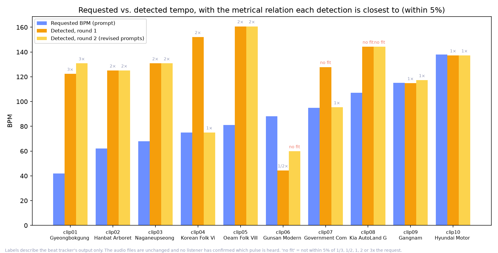
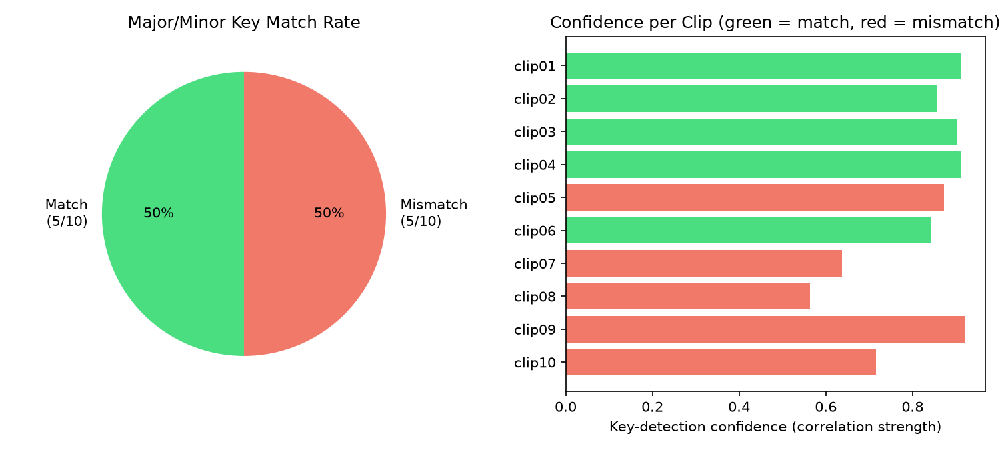

# Moodscape — 프롬프트 대비 실제 생성 음원 검증 보고서

**이 보고서는 이 프로젝트에서 처음으로 근사치가 아닌 실제 생성된 음원을 기반으로 작성되었습니다.**
사용자가 직접 제공한 `sunoapi.org` API 키(로컬의 `.env` 파일에만 저장, git에 커밋되지 않고 로그에도
출력되지 않음)로 실제 API를 호출해 10개의 실제 트랙을 생성했으며, `audio.js`의 `sunoGenerate()`와
완전히 동일한 요청 형식을 사용했습니다. 각 파일은 실제 오디오 파형에서 직접 템포와 조성(key)을
추출·분석한 뒤, 프롬프트가 요청했던 값과 비교했습니다.

## 방법론

1. **생성** (`research/generate_listener_clips.py`): `research/listener_stimulus_metadata.csv`에
   준비되어 있던 10개의 프롬프트를 `sunoapi.org`의 `/api/v1/generate` 엔드포인트로 전송하고,
   `/api/v1/generate/record-info`를 폴링하여 오디오 URL을 받아 mp3 파일로 다운로드했습니다.
   10개 전부 성공했습니다.
2. **분석** (`research/analyze_generated_audio.py`): 각 mp3 파일을 `librosa`로 불러와
   `librosa.beat.beat_track()`으로 템포(BPM)를 추정하고, Krumhansl-Schmuckler 알고리즘(크로마
   벡터를 Krumhansl & Kessler(1982)의 표준 공인 조성 프로파일과 상관분석)으로 장조/단조를
   추정했습니다 — 이 프로젝트를 위해 새로 고안한 방식이 아니라 학계에서 표준으로 쓰이는 방법입니다.
   이 도구는 옥타브를 고려한 템포 판독(아래 설명)과 트랙별 이벤트 밀도(초당 온셋 수)도 함께 출력합니다.
3. **비교**: 각 클립의 실제 `buildSunoPrompt()` 출력에 담긴 요청 BPM/조성과, 실제 오디오에서
   검출된 BPM/조성을 비교했습니다.
4. **재현성**: 아래의 모든 그림과 통계는 분석기가 출력한 CSV에서 `research/build_audio_report_figures.py`로
   다시 만들어집니다. 보고서의 첫 버전은 커밋되지 않은 임시 스크립트에서 나온 옥타브 보정 수치를
   인용했습니다. 이를 바로잡으면서 무엇이 바뀌었는지는 맨 끝의 "수정 이력"을 참고하세요.

## 결과

1차는 이 보고서의 대상인 최초 생성분입니다. 2차(오른쪽 열)는 같은 10개 장소를 개선된 프롬프트와 요청
형식으로 다시 생성한 것으로(`MINOR_KEY_FIDELITY_STUDY.md` 참고), 템포 관련 결론이 한 번의 생성에만
의존하지 않도록 함께 실었습니다.

| 지표 | 1차 | 2차 |
|---|---|---|
| 생성 및 분석된 클립 수 | 10 / 10 | 10 / 10 |
| 장조/단조 일치율 | **5/10 (50%)** | 7/10 (70%) |
| 원본(보정 전) 평균 BPM 편차 | 70.6% | 57.4% |
| **옥타브를 고려한 평균 BPM 편차** (검출값이 요청의 ⅓, ½, 1, 2, 3배 중 하나일 수 있다고 허용) | **7.7%** | 7.7% |
| 옥타브를 고려한 중앙값 BPM 편차 | 1.1% | 1.4% |
| 요청 템포의 표준 배수와 5% 이내로 일치 | 8/10 | 8/10 |
| &nbsp;&nbsp;— 그중 1배(요청대로의 템포) | 2 (clip09, clip10) | 4 (clip04, 07, 09, 10) |
| &nbsp;&nbsp;— 그중 2배·3배·½배 | 6 (clip01 3배, clip02–05 2배, clip06 ½배) | 4 (clip01 3배, clip02·03·05 2배) |
| **어떤 표준 배수와도 5% 이내로 맞지 않음** | 2 (clip07, clip08) | 2 (clip06, clip08) |
| 일치한 클립들의 평균 조성 검출 신뢰도 | 0.885 | 0.875 |
| 불일치한 클립들의 평균 조성 검출 신뢰도 | 0.742 | 0.791 |
| 요청 ≤ 81 BPM vs ≥ 107 BPM 클립의 초당 평균 온셋 수 | 2.5 vs 6.4 | 2.7 vs 7.2 |

## 가장 중요한 발견: 원본 BPM 수치는 오해하기 쉽지만, 보정에도 한계가 있습니다

"70.6% 벗어남"이라는 표면적인 수치만 보면 실제 오디오가 프롬프트와 거의 무관해 보입니다. 하지만
대부분의 클립에서는 그렇지 않습니다. 1차에서 10개 중 6개의 검출 템포가 요청 템포의 단순한 배수에
거의 정확히 놓여 있습니다. clip02·03·04·05는 약 2배(0.8–3.8% 차이), clip06은 약 ½배(0.7% 차이),
clip01은 약 3배(122.3 BPM, 3 × 42 = 126과 3.0% 차이)입니다. 나머지 두 개(clip09, clip10)는 요청과 직접
일치합니다. 느리고 성긴, 발현악기나 아르페지오가 많은 음악에서는 흔히 이런 일이 생깁니다. 비트 추적
알고리즘이 사람이 손으로 짚을 느린 박 대신 음표의 더 빠른 세분 단위에 고정되기 때문입니다. 이는 템포
추정 도구 전반의 알려진 특성이며, Moodscape의 프롬프트나 Suno의 결과물에 특정된 증거가 아닙니다.

**이 배수들을 허용하면**(⅓, ½, 1, 2, 3배 — 템포 추정 평가에서 표준으로 쓰이는 허용 범위) 평균 편차가
70.6%에서 **7.7%**로, 중앙값은 **1.1%**로 떨어집니다. 2차도 평균 7.7%, 중앙값 1.4%로 같은 결과입니다.
**이는 오디오가 바뀌었거나 다시 생성되었거나 실제로 "보정"되었다는 뜻이 아닙니다 — mp3 파일은 그대로입니다.**
검출기가 낸 숫자를 다시 읽을 뿐입니다. librosa가 하나의 BPM 값을 보고했고, 이 단계는 그 값이 프롬프트가
요청한 템포의 단순한 배수인지를 묻습니다. 이것은 검출 도구에 대한 설명이지, 청취자가 느낄 템포에 대해
검증된 사실이 아닙니다. 사람이 이 트랙을 직접 들으며 어느 박을 짚을지 확인한 적은 없습니다.

**보정으로 설명되지 않는 두 가지.** 1차의 clip07(요청 95, 검출 127.8)과 clip08(요청 107, 검출 144.2)은
어떤 표준 배수에서도 약 33% 벗어나 있고, 둘 다 요청의 약 4⁄3에 가깝습니다. 2차에서는 clip08이 그대로
반복되고(다시 144.2) clip06(요청 88, 검출 59.8, 약 ⅔)이 추가됩니다. 이것은 옥타브 오검출이 아니며,
이 보고서에는 설명이 없습니다. 3연음이나 복합 박자 느낌이 이런 비율을 만들 수는 있지만 검증되지 않은
추측일 뿐이고, 검출기를 또 돌리는 것이 아니라 사람이 들어봐야 확인할 수 있습니다.

**느린 요청이 실제로 반영되고 있는가?** 증거는 있지만 증명에는 못 미칩니다. 10개 요청 템포 전체에서
요청 BPM과 초당 온셋 수의 순위 상관은 ρ = 0.93입니다(클립 평균 n = 10, 디스크의 트랙 40개를 합산,
기술 통계일 뿐, `research/slow_song_diagnostic.py`). 느린 요청(≤ 81 BPM)은 초당 평균 2.5개, 빠른
요청(≥ 107 BPM)은 6.4개이고, 느린 클립은 요청한 박 하나당 약 2.3개의 이벤트를 담고 있습니다. 이는 요청
템포의 박을 8분음표로 쪼갠 경우에 나올 값입니다. 따라서 추적기가 2–3배로 보고하는 경우에도 더 느리고
성긴 느낌은 존재하는 것으로 보입니다. 주의할 예외는 가장 낮은 요청인 clip01(42 BPM)입니다. clip01의
5개 트랙(1차, 2차, 프롬프트에 일정한 박 문장을 더한 3회 테스트)에서 42 BPM은 가장 강한 템포 피크 3개
안에 한 번도 들지 못했습니다. Suno가 만들 수 있는 하한보다 42 BPM이 낮을 수 있다는 뜻입니다. 그 박
문장 수정 자체도 효과가 없었습니다. 9개 트랙 중 요청 템포가 상위 3개 피크에 든 것은 4개, 가장 강한
피크였던 것은 0개입니다(`research/slow_pulse_results.json`).

## 조성(장조/단조) 결과는 정말로 50대 50입니다 — 얼버무릴 수 없는 결과

템포와 달리 장조/단조에는 "옥타브 보정" 같은 것이 없습니다 — 트랙은 장조이거나 단조이거나 둘 중
하나로 검출됩니다. **1차에서 10개 중 5개 클립만 요청한 조성과 일치했습니다.** 이 결과는 있는 그대로
받아들일 필요가 있습니다 — 현재 파이프라인(프롬프트 텍스트 → Suno → 실제 결과물)이 요청한
장조/단조를 보존하는 확률이 대략 절반 정도라는 뜻입니다.

불일치 사례에서 발견한 실제 패턴 하나: **일치한 클립들의 평균 조성 검출 신뢰도(0.885)가 불일치한
클립들의 신뢰도(0.742)보다 뚜렷하게 높습니다.** 5개의 불일치 중 2개(clip07: 0.638, clip08: 0.563)는
전체 데이터셋에서 가장 낮은 신뢰도를 보였는데, 이는 이 두 트랙이 실제로 장조와 단조 어느 쪽으로도
뚜렷하게 판단하기 어려운, 진짜로 조성이 모호한 곡일 가능성을 시사합니다. 반면 나머지 3개의
불일치(clip05: 0.873, clip09: 0.921, clip10: 0.716)는 오히려 "틀린" 조성으로 더 확신 있게 검출된
경우로, 이는 검출기의 오류라기보다 Suno의 생성 단계에서 조성 요청이 실제로 반영되지 않았을
가능성이 더 높다는 신호입니다.

2차(개선된 프롬프트와 요청 형식)에서는 일치율이 7/10으로 올랐지만, 여전히 남아 있던 단조 요청 두 개
(clip09, clip10)는 이번에도 장조로 나왔습니다. 클립별로 보면 clip05, clip07, clip08은 일치로 바뀌었고
clip06은 일치하지 않게 되었습니다. 요청 자체가 바뀐 것은 clip07뿐입니다(세종은 이제 장조로 요청).
clip05와 clip08은 장조 요청 그대로인데 이번에는 장조로 나왔을 뿐이며, 이는 프롬프트 변경만큼이나 Suno
출력이 실행마다 달라진다는 것과 일치합니다. 자세한 조사와 한계는 `MINOR_KEY_FIDELITY_STUDY.md`를
참고하세요.

## Moodscape 자체 주장에 대해 갖는 의미

- `about.html`은 무드 점수에서 음악 파라미터로의 매핑을 "사운드화 공식(sonification formula)"이라고
  설명합니다. 이 보고서는 그 공식의 *출력 텍스트*가 제3자 서비스(Suno)를 거쳐 실제 오디오로
  바뀌는 과정에서 얼마나 충실히 유지되는지를 실제로 검증한 첫 사례입니다. 이번 표본 기준으로
  정직하게 답하자면: 템포는 각 차수마다 10개 중 8개 클립에서 요청 템포의 단순한 배수와 일치하고,
  차수마다 두 클립은 어떤 표준 배수로도 설명되지 않으며, 가장 낮은 요청(42 BPM)은 한 번도 재현되지
  않았습니다. 조성(장조/단조)은 1차에서 안정적으로 보존되지 않았고, 2차에서도 단조 요청은 여전히
  지켜지지 않았습니다.
- 이는 `PROMPT_OUTPUT_COMPARISON_REPORT.md`에 이미 기록되어 있던 우려를 직접 뒷받침합니다:
  프롬프트에 "minor key"라고 적어도, Suno가 실제로 단조 트랙을 생성했는지 확인하는 검증 단계가
  없다는 점입니다. 이 보고서는 그 우려를 이론적 위험이 아니라 실제 오디오로 처음 검증한 사례입니다.

## 이 분석 자체의 한계

- 표본 수 n=10은 실제로 유의미한 패턴을 보여주기엔 충분하지만, 전체 카탈로그에 대해 "조성 충실도가
  정확히 50%"라고 정밀하게 단정하기엔 작은 표본입니다.
- 자동 조성 검출 자체도 완벽하지 않습니다 — 공인된 표준 알고리즘을 사용했더라도 마찬가지입니다.
  위에서 발견한 신뢰도-일치 여부 상관관계는 저신뢰도 불일치가 "실제로" 모호한 곡이라는 정황
  증거이지, 증명은 아닙니다.
- 사람이 직접 들어보며 자동 검출 결과를 교차 확인하지는 않았습니다 — 이 수치를 최종 결론으로
  삼기 전에 해볼 가치가 있는 수작업 단계로 남아 있습니다. 템포에서 특히 중요합니다. 배수로 읽는
  것은 검출기에 대한 주장이고, 느린 클립이 실제로 *느리게 느껴지는지*는 청취자만 말할 수 있습니다.
- 이벤트 밀도 증거(초당 온셋 수, 요청한 박당 이벤트 수)는 기술 통계입니다. 온셋 검출기는 어택을 세기
  때문에, 느린 박의 드론과 성긴 빠른 곡이 비슷한 값을 낼 수 있습니다. 클립 평균 10개에서 ρ = 0.93은
  효과의 크기가 아니라 방향을 보여줍니다.
- 2차는 같은 생성기에서 한 번 더 뽑은 결과이지 가설에 대한 독립적인 재현이 아닙니다. Suno의 출력은
  확률적이어서 같은 프롬프트도 다르게 나올 수 있습니다.

## 권고 사항

- "조성 충실도 50%"는 이제 추측이 아니라 실제로 측정된 수치이므로, `about.html`의 한계(limitations)
  섹션에 Suno의 충실도 문제로 명시적으로 기록할 가치가 있습니다.
- 조성 충실도는 이후 별도로 조사되었습니다(`MINOR_KEY_FIDELITY_STUDY.md`). 근음(root note)을 지정해도
  음높이는 제어되지 않았고, 모든 장소에 일반화되는 단일 문구 수정도 없었습니다. 조성은 "부분적으로
  제어 가능"한 것이지 "해결된" 것이 아닙니다.
- 느린 곡의 경우 프롬프트나 BPM 공식을 바꾸기 전에, clip01, clip02, clip03, clip10을 라벨 없이 무작위
  순서로 들어보고 각각 느껴지는 박이 느린지(초당 1박 정도 이하) 빠른지 기록하세요. 청취자가 clip01–03을
  느리다고 느낀다면 "실패"는 검출기의 문제이므로 음악을 바꾸지 말고 앱이 그 사실을 설명해야 합니다.
  빠르다고 느낀다면 문제는 프롬프트이며 템포 하한(60–62 BPM)을 시험해 볼 만합니다. 현재 증거는 어느
  쪽의 변경도 뒷받침하지 않습니다.
- Suno의 기반 모델이 바뀌면 이 파이프라인을 주기적으로 다시 돌려볼 필요가 있습니다 — 여기서 측정한
  충실도는 현재 모델 버전의 특성이지, 시스템의 영구적인 성질이 아닙니다.

## 수정 이력

이 보고서는 처음 공개된 뒤에 수정되었습니다. 무엇이 왜 바뀌었는지는 다음과 같습니다.

- **옥타브 보정 평균이 12.3%에서 7.7%로 내려갔습니다.** 첫 버전은 ½배와 2배만 허용했고 커밋되지 않은
  임시 스크립트에서 계산했기 때문에, clip01(요청 42, 검출 122.3)이 45% 벗어난 것으로 채점되었습니다.
  실제로는 요청의 거의 정확히 3배(3.0% 차이)입니다. 분석기(`analyze_generated_audio.py`)는 이제 ⅓, ½,
  1, 2, 3배를 사용하고, `build_audio_report_figures.py`가 그 출력에서 이 보고서의 모든 그림과 통계를
  다시 만듭니다. 중앙값(1.1%)은 그대로입니다.
- **"6개 클립이 2배 또는 ½배"가 "6개 클립이 2배(4개), ½배(1개), 3배(1개)"로 바뀌었습니다.**
- **두 클립(clip07, clip08)은 이제 "설명되지 않음"으로 명시했습니다.** 옥타브 설명에 억지로 포함하지
  않았습니다. 2차에도 두 개(clip06, clip08)가 있습니다.
- **템포가 "상당히 잘 보존된다"는 주장은 데이터가 뒷받침하는 범위로 좁혔고**, 42 BPM 하한 관찰과
  효과가 없었던 박 문장 테스트를 추가했습니다.
- 2차 결과, 이벤트 밀도 증거, 느린 곡 청취 테스트를 추가했습니다. 오디오 파일과 조성 일치 관련
  결과는 그대로입니다.
